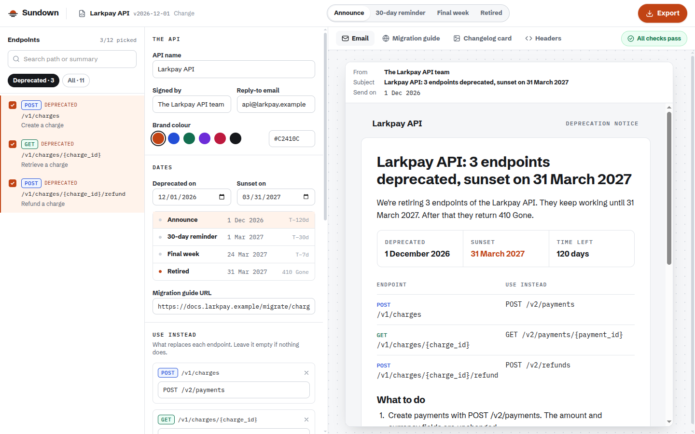
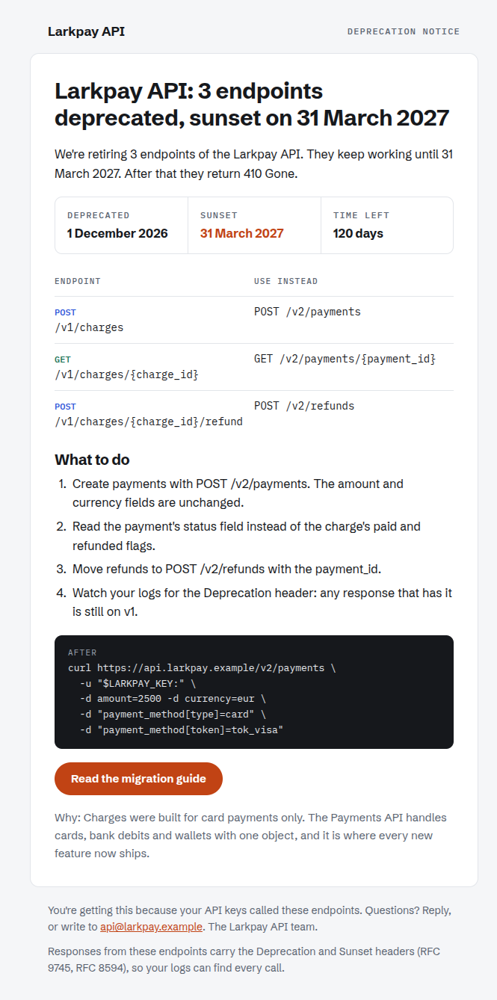
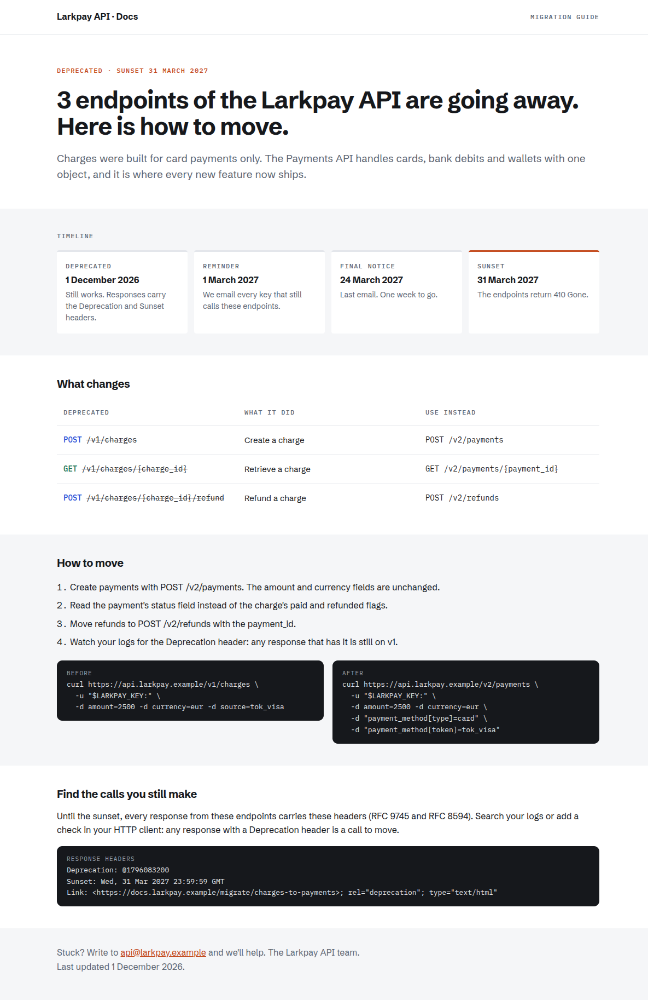
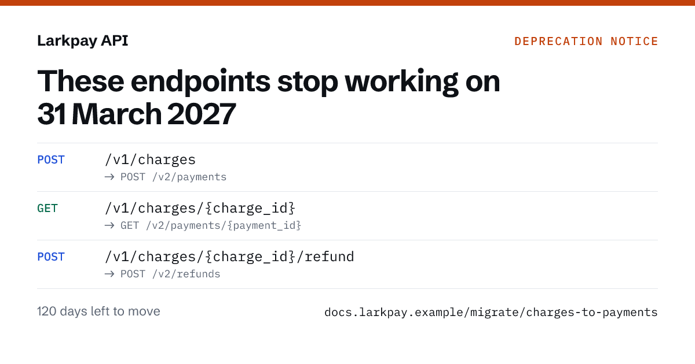
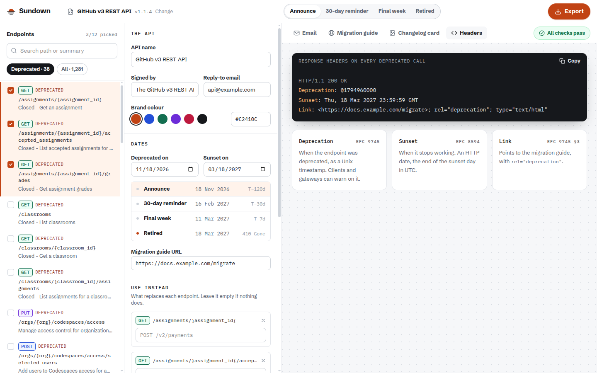

# Sundown

**Retire an API endpoint without breaking anyone.** Load your OpenAPI spec. Sundown finds the operations marked
`deprecated: true` and writes everything you send about them: four emails (announce, 30-day reminder, final week,
retired), a migration guide page, a changelog card, and the `Deprecation` / `Sunset` / `Link` response headers.

Built with [Hyper Elements](https://github.com/hyper-elements/hyper-elements) for the Hyper Elements Template Challenge.

**Live:** https://sundown.rohitkashyapmrt.workers.dev



## Why this exists

Every API retires endpoints, and the notice is where it goes wrong:

- "You don't know how many of those emails land in inboxes of people who don't care, understand or are simply
  swamped. I ran into so many hard sunsets…" ([r/developers, Feb 2026](https://www.reddit.com/r/developers/comments/1rgddud/))
- "Alerts weren't sent until Friday afternoon… Major impacts for so many orgs." ([r/salesforce, Jan 2026](https://www.reddit.com/r/salesforce/comments/1qp0q1y/))
- GitHub's own REST description has **38 deprecated operations out of 1,281**
  ([github/rest-api-description](https://github.com/github/rest-api-description), Nov 2026).

The rules for doing it properly already exist. [Zalando's API guidelines](https://github.com/zalando/restful-api-guidelines/blob/main/chapters/deprecation.adoc)
say you MUST mark deprecation in the spec, give a sunset date, and document what to use instead and how to migrate.
[RFC 9745](https://www.rfc-editor.org/rfc/rfc9745.html) and [RFC 8594](https://www.rfc-editor.org/rfc/rfc8594.html)
define the headers. Sundown turns the spec you already have into all of it, as a sequence, so the swamped still see it.

## What it makes

| Output | Hyper Elements root | What it's for |
|---|---|---|
| Email (HTML + plain text), in 4 sends | `<Email>` | the owners of API keys that still call the endpoints |
| Migration guide | `<Page>` | the page every notice links to, and the `rel="deprecation"` target |
| Changelog card, 1200 × 630 PNG | `<Canvas>` → `renderImage()` | the changelog post, X/LinkedIn, the guide's Open Graph image |
| Response headers | (computed) | `Deprecation: @…`, `Sunset: <HTTP-date>`, `Link: <guide>; rel="deprecation"` |

| The email | The migration guide | The card |
|---|---|---|
|  |  |  |

The studio also loads GitHub's real spec (14 MB, 1,281 operations) in the browser:



And the landing page, 6 sections with an FAQ: [media/landing.png](media/landing.png).

## How Hyper Elements is used

The three outputs are **Hyper Elements templates** (`template()` from `@hyper-elements/react/template`), in
`templates/`. The web app and the CLI render the same three files.

- **Typed fields with rules** (`templates/_shared/notice.tsx`). A path must start with `/`. The reply-to must look
  like an email. A notice has 1 to 12 endpoints. Methods are a fixed choice. If a value breaks a rule, the render
  stops and says which field and why. In the studio, those messages appear in the "checks" badge.
- **Three roots.** `<Email>` for the notice, `<Page>` for the migration guide, `<Canvas>` for the card. The card is
  drawn to PNG by `renderImage()` in a Next.js browser (`src/lib/render-route.ts`, so the site runs on Cloudflare with no render server).
- **One field, four sends.** `stage` (announce / reminder / final / retired) changes the subject, the tag, the lead
  and the "time left", so the same notice gives the whole email sequence.
- **Rules over the result.** Email and page require lint's `contrast`, `link-text` and `lang`. The card requires
  `image/overflow`, `image/fit` and `image/glyph`. These caught real bugs while building: an arrow character the font
  didn't have (it would have printed as an empty box), and GitHub's longest paths not fitting on one line. Both
  are fixed.
- **`fit`** on the card's headline and paths: the text is drawn at the largest size that fits.
- **A theme** (`defineTheme`) built from the team's brand colour, with named styles (`eyebrow`, `card`).
- **`Svg` + `Path`** for the arrow on the card.
- **Values files + CLI.** `npm run notices` turns `notices/larkpay.json` into checked values files with
  `hyper-elements design new` and renders them with `hyper-elements render`. You can do the same in CI. The studio's
  Export → "Notice for the CLI" gives you that JSON.
- **Email client checks.** `@hyper-elements/email-clients` runs on every render, and `npm run preview:email` writes
  the email as Outlook, Gmail and Apple Mail show it.

## Run it

Needs Node 20+.

```bash
npm install
npm run dev            # http://localhost:3000 (landing) and /studio (the app)
```

In the studio, pick **Larkpay** (a made-up sample API) or **GitHub REST API** (the real spec, fetched from GitHub),
paste your own spec's URL, or upload a JSON/YAML file. Your spec stays in your browser. Only the notice is sent to
the local render route.

Without the app:

```bash
npm run check          # check the three templates with their example
npm run notices        # notices/larkpay.json → out/notices/ (email .html/.txt, page .html, card .png)
npm run preview:email  # out/clients/…: the email in Outlook, Gmail, Apple Mail
npm run build && npx wrangler dev   # the static site, served the way Cloudflare does
```

## Use it for your own API

1. Mark the operations in your spec: `deprecated: true`, and optionally `x-sunset: "2027-03-31"`.
2. Open `/studio`, load the spec, and pick the endpoints. Set the sunset date, say what replaces each endpoint, and
   add the steps and the before/after code.
3. Export the email for each stage and send it on the date in the timeline. Host the migration guide at your guide
   URL. Post the card with your changelog entry. Add the three headers to the old endpoints' responses.

## Project layout

```
templates/_shared/notice.tsx  the fields, look, sample and copy for each stage
templates/_shared/dates.ts    sunset maths and the RFC 9745 / 8594 headers (no imports; the browser uses it too)
templates/email.tsx           Email template
templates/page.tsx            Page template (migration guide)
templates/card.tsx            Canvas template (1200 × 630)
src/app/page.tsx              landing page
src/components/Studio.tsx     the studio
src/lib/render-route.ts       renders a notice with the templates: render() and renderImage()
src/lib/spec.ts               reads OpenAPI 3 / Swagger 2, JSON or YAML
notices/                      the sample notice and its values files (CLI)
public/samples/               the Larkpay sample spec
fonts/                        Schibsted Grotesk + IBM Plex Mono (SIL Open Font License)
```

## Sample data

Larkpay is a made-up payments API. Its domain is `larkpay.example`, a reserved name that can't belong to anyone.
The GitHub sample is GitHub's real public OpenAPI description, loaded live.

## License

MIT for the code. Fonts: Schibsted Grotesk and IBM Plex Mono, SIL Open Font License 1.1 (`fonts/OFL-*.txt`).
